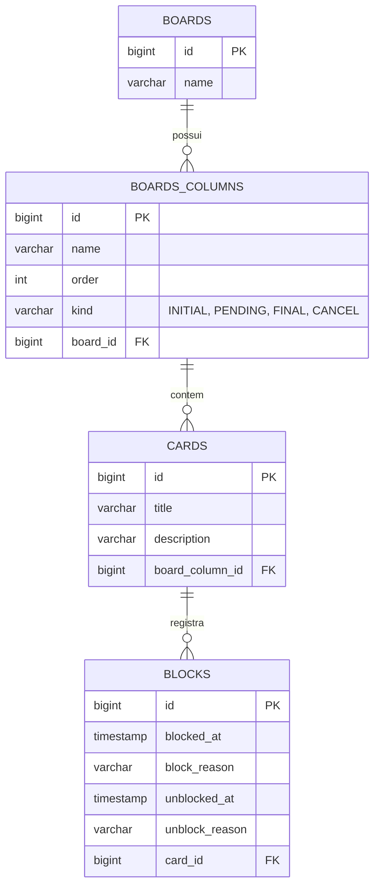

# Board de Tarefas — Desafio DIO

Gerenciador de tarefas no estilo Kanban, em Java, rodando no terminal e com os dados salvos em MySQL.
Baseado no projeto de referência: [digitalinnovationone/board](https://github.com/digitalinnovationone/board).

## Funcionalidades

**Menu principal**
- Criar um board, com colunas personalizadas
- Selecionar um board
- Excluir um board

**Menu do board**
- Criar um card (entra sempre na coluna inicial)
- Mover um card para a próxima coluna
- Bloquear e desbloquear um card, informando o motivo
- Cancelar um card
- Ver o board, uma coluna com seus cards ou os detalhes de um card

## Regras
- Todo board tem 3 colunas obrigatórias: **inicial**, **final** e **cancelamento**. Entre a inicial e a final podem existir quantas colunas **pendentes** você quiser.
- Os cards avançam uma coluna por vez, na ordem.
- Um card bloqueado não pode ser movido nem cancelado.
- Um card na coluna final ou na de cancelamento não pode mais ser movido, cancelado nem bloqueado.
- O histórico de bloqueios fica salvo, e a tela do card mostra quantas vezes ele já foi bloqueado.

## Diagrama do banco



## Tecnologias
- Java 21+
- MySQL e JDBC
- Liquibase, que cria as tabelas automaticamente ao iniciar
- Maven, com wrapper incluído (não precisa instalar o Maven)

## Estrutura
```
src/main/java/br/com/dio/board/
├── Main.java
├── dto/                     records usados nas consultas
├── exception/               exceções de regra de negócio
├── persistence/
│   ├── config/              conexão com o banco
│   ├── dao/                 acesso ao banco (SQL)
│   ├── entity/              entidades do domínio
│   └── migration/           execução do Liquibase
├── service/                 regras de negócio e transações
└── ui/                      menus do terminal
src/main/resources/db/changelog/   migrations do banco
```

## Melhorias em relação ao original
- Configuração do banco por variáveis de ambiente, em vez de senha fixa no código
- Lista dos boards cadastrados antes de selecionar ou excluir
- Validação das entradas: o programa pede de novo quando o valor é inválido
- Um card só pode ser alterado dentro do board ao qual pertence
- Commit e rollback centralizados em um único lugar (`Transactions`)
- Sem Lombok: usa `record` do Java nos DTOs

## Como executar

1. Tenha o MySQL rodando. O banco `board` é criado automaticamente.
2. Configure o acesso, se for diferente do padrão (`root` / `root` em `localhost:3306`):
   ```bash
   # Git Bash / Linux / macOS
   export DB_USER=root
   export DB_PASSWORD=sua_senha
   # PowerShell
   $env:DB_USER="root"; $env:DB_PASSWORD="sua_senha"
   ```
   Também é possível trocar a URL inteira com `DB_URL`.
3. Compile e rode:
   ```bash
   ./mvnw package
   java -jar target/board.jar
   ```
   No Windows (cmd/PowerShell), use `mvnw.cmd package`.
